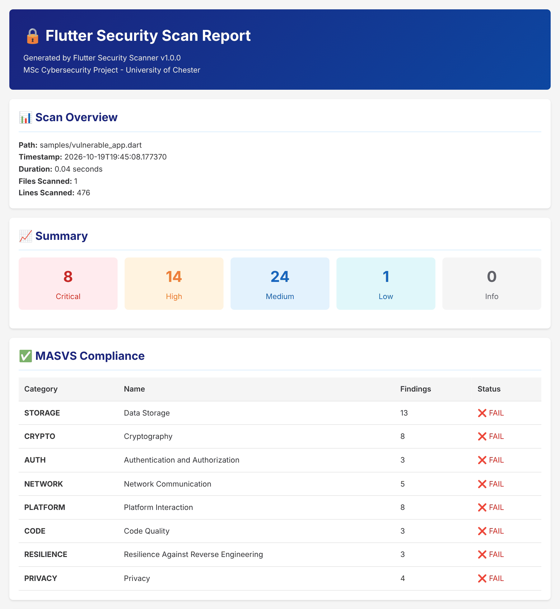

# Flutter Security Analyzer

[](https://github.com/eCaleb/flutter-security-analyzer/actions/workflows/ci.yml)
[](LICENSE)

A static analysis tool for detecting security vulnerabilities in Flutter/Dart applications with OWASP MASVS v2.1.0 compliance mapping.

## Academic Project

This tool is developed as part of an MSc Cybersecurity final year project at the University of Chester.

**Author:** Caleb Elebhose  
**Supervisor:** Dr. Bismark Asare  
**Module:** WB7103/WB7104

## Features

- **Pattern-Based Detection**: Regex-based vulnerability detection for Dart code
- **MASVS Compliance Mapping**: All findings mapped to OWASP MASVS v2.1.0 controls
- **Multiple Output Formats**: Console, JSON, and HTML reports
- **CI/CD Integration**: Exit codes suitable for pipeline integration
- **26 Vulnerability Checks**: Covering all 8 MASVS categories

## Sample Report



The HTML report from scanning `samples/vulnerable_app.dart`, which contains deliberate vulnerabilities: 47 findings across all 8 MASVS categories.

## MASVS Categories Covered

| Category | Description | Checks |
|----------|-------------|--------|
| STORAGE | Data storage security | 4 |
| CRYPTO | Cryptographic implementations | 3 |
| AUTH | Authentication and authorization | 3 |
| NETWORK | Network communication security | 3 |
| PLATFORM | Platform interaction security | 4 |
| CODE | Code quality and injection prevention | 4 |
| RESILIENCE | Anti-reverse engineering | 3 |
| PRIVACY | User privacy protection | 2 |

Most checks run line by line on `.dart` files. A few look at project configuration instead:

| Check | Files read |
|-------|------------|
| Missing certificate pinning, missing root/jailbreak detection | `pubspec.yaml` (dependencies) |
| Vulnerable third-party dependencies | `pubspec.yaml` |
| Outdated minimum SDK version | `android/app/build.gradle`, `android/app/build.gradle.kts`, `ios/Podfile` |
| Missing code obfuscation | CI workflows (`.github/workflows/*.yml`, `.gitlab-ci.yml`, `codemagic.yaml`, `bitrise.yml`), `Makefile` and shell scripts in the project root or `scripts/` |

Only the check listed for a file is applied to it, and comment lines are ignored.

## Installation

```bash
# Clone the repository
git clone https://github.com/eCaleb/flutter-security-analyzer.git
cd flutter-security-analyzer

# Install as a package, which adds the flutter-security-analyzer command
pip install .

# Optional: development dependencies (pytest, coverage, linters)
pip install -r requirements.txt
```

The scanner has no runtime dependencies beyond the Python standard library (Python 3.9 or later). You can also run it straight from the source tree with `python src/main.py` instead of installing it.

## Usage

### Basic Scan

```bash
flutter-security-analyzer /path/to/flutter/project

# or, without installing
python src/main.py /path/to/flutter/project
```

### Output Formats

```bash
# Console output (default)
flutter-security-analyzer ./my_flutter_app

# JSON output
flutter-security-analyzer ./my_flutter_app -f json -o results.json

# HTML report
flutter-security-analyzer ./my_flutter_app -f html -o report.html
```

### Filter by Severity

```bash
# Only show high and critical findings
flutter-security-analyzer ./my_flutter_app -s high
```

### Filter by MASVS Category

```bash
# Only scan for STORAGE and CRYPTO issues
flutter-security-analyzer ./my_flutter_app --masvs-category STORAGE CRYPTO
```

### Verbose Mode

```bash
flutter-security-analyzer ./my_flutter_app -v
```

## CI/CD Integration

### Exit Codes

- `0`: No high or critical findings
- `1`: High severity findings detected
- `2`: Critical findings detected

### GitHub Actions Example

```yaml
- name: Security Scan
  run: |
    pip install git+https://github.com/eCaleb/flutter-security-analyzer
    flutter-security-analyzer ./lib -f json -o security-results.json
```

### Docker

```bash
# Build the image (this also runs the unit tests)
docker build -t flutter-security-analyzer .

# Scan a project mounted at /scan
docker run -v $(pwd):/scan flutter-security-analyzer /scan
```

## Known Limitations

- Detection is pattern-based. The scanner matches regular expressions against the source rather than tracing how data flows between functions or files, so expect some false positives and some missed issues. A shared whitelist filters common false positives, such as security keywords in function and class names.
- It scans `.dart` files plus the configuration files listed above. Apart from the build files used for the minimum SDK check, the `android/` and `ios/` folders are skipped, as are test folders, so it does not check `AndroidManifest.xml`, `Info.plist`, native code or compiled builds.
- The dependency check only recognises a short list of known outdated versions written with a caret (for example `http: ^0.13.0`). It is not a full vulnerability database lookup, so use `flutter pub outdated` as well.
- Findings are a starting point for review, not proof of a vulnerability. Check each one in context before acting on it.

## Project Structure

```
flutter-security-analyzer/
├── src/
│   ├── main.py              # CLI entry point
│   ├── core/
│   │   ├── scanner.py       # Main scanner logic
│   │   └── config.py        # Configuration handling
│   ├── patterns/
│   │   ├── base_pattern.py  # Pattern base class
│   │   ├── pattern_registry.py
│   │   ├── storage_patterns.py
│   │   ├── crypto_patterns.py
│   │   ├── auth_patterns.py
│   │   ├── network_patterns.py
│   │   ├── platform_patterns.py
│   │   ├── code_patterns.py
│   │   ├── resilience_patterns.py
│   │   └── privacy_patterns.py
│   ├── mappers/
│   │   └── masvs_mapper.py  # MASVS compliance mapping
│   └── reporters/
│       ├── console_reporter.py
│       ├── json_reporter.py
│       └── html_reporter.py
├── tests/
├── docs/images/             # README screenshots
├── samples/                 # Deliberately vulnerable and secure sample apps
├── .github/workflows/
├── Dockerfile
├── requirements.txt
├── setup.py
└── README.md
```

## Testing

```bash
# Run all tests
pytest

# With coverage
pytest --cov=src tests/
```

## License

MIT License - See LICENSE file for details.

## Acknowledgements

- OWASP Mobile Application Security Project
- University of Chester Cybersecurity Department

## References

- [OWASP MASVS v2.1.0](https://mas.owasp.org/MASVS/)
- [OWASP Mobile Security Testing Guide](https://mas.owasp.org/MSTG/)
- [Flutter Security Documentation](https://flutter.dev/security)
